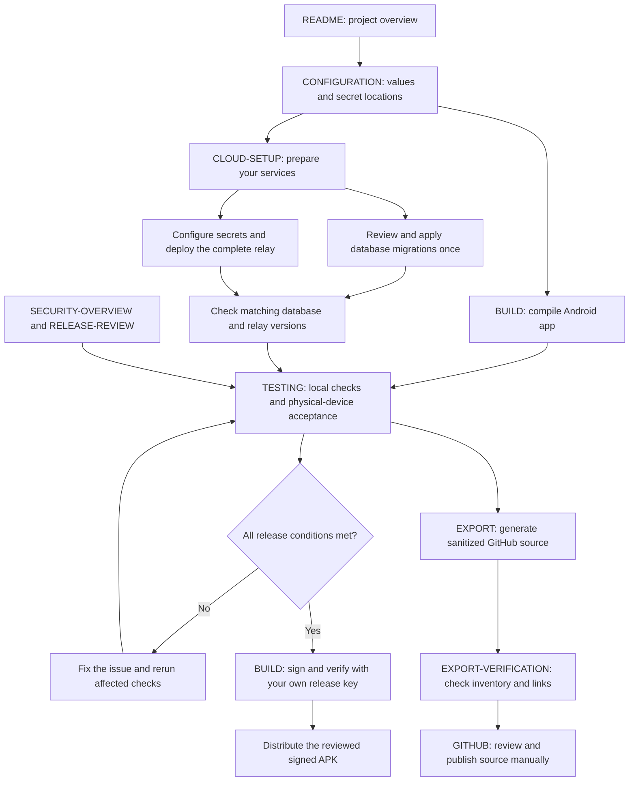
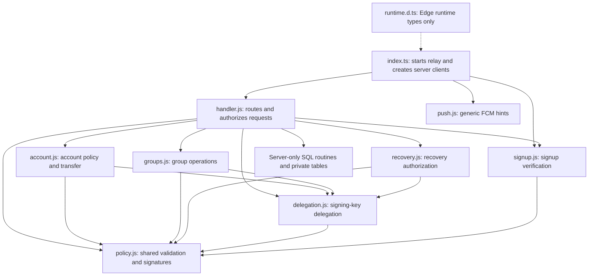
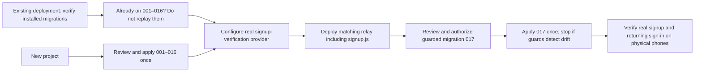
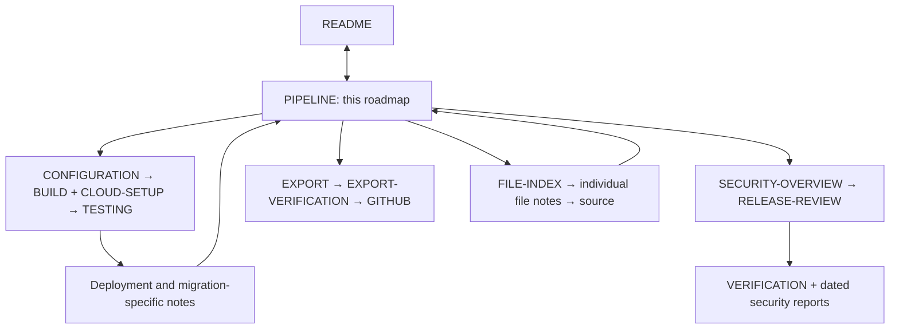

# Developer roadmap

[Overview](../README.md) · [Developer roadmap](PIPELINE.md) · [File index](FILE-INDEX.md)

Start here to follow the project from setup to a signed APK. The arrows show dependencies, not automatic jobs: building, deploying, exporting and publishing are separate actions. Diagrams render on GitHub; the linked reading order below also works in a plain Markdown viewer.

## 1. From a fresh checkout to release



| Step | Read | Continue with |
| --- | --- | --- |
| Understand the app | [Project overview](../README.md) | [Configuration](CONFIGURATION.md) |
| Supply your own connection values | [Configuration](CONFIGURATION.md) | [Build](BUILD.md) and [Cloud setup](CLOUD-SETUP.md) |
| Build and sign Android | [Build](BUILD.md) | [Tests](TESTING.md) |
| Configure Auth, SQL, relay and optional push | [Cloud setup](CLOUD-SETUP.md) | [Tests](TESTING.md) |
| Check behavior and security | [Tests](TESTING.md), [Security overview](SECURITY-OVERVIEW.md) | [Release review](RELEASE-REVIEW.md) |
| Prepare public source | [Export scope and update process](EXPORT.md) | [Export verification](EXPORT-VERIFICATION.md) |
| Publish reviewed source | [GitHub guide](GITHUB.md) | Review generated files before uploading |
| Find a class, migration or test | [File index](FILE-INDEX.md) | Its individual note links to the source and back here |

A placeholder-only build can compile without working cloud configuration. It cannot prove real sign-in, notification delivery or provider verification. A passing export check also does not mean the application is approved for production.

## 2. What happens on the phones and server

```mermaid
sequenceDiagram
    participant S as Sender phone
    participant V as Encrypted local Vault
    participant R as Supabase relay
    participant D as Private SQL queue
    participant F as Google FCM (optional)
    participant P as Recipient phone
    Note over S,R: Sign-in checks password and installation binding; protected calls need a live session
    S->>S: Encrypt and sign the message
    S->>V: Save encrypted pending message
    S->>R: HTTPS: signed, end-to-end encrypted envelope
    R->>R: Check session, proof, routing, permissions and limits
    R->>D: Store validated encrypted envelope
    opt Background notification enabled
        R-->>F: Generic wake-up hint
        F-->>P: Request authenticated sync
    end
    P->>R: Authenticated inbox request
    R->>D: Read authorized recipient queue
    D-->>R: Authorized encrypted envelopes
    R-->>P: Return encrypted inbox
    P->>P: Verify sender, routing and message; decrypt
    P->>P: Durably save to encrypted local storage
    P->>R: Acknowledge saved message IDs
    R->>D: Remove acknowledged queued copies
```

Push is a hint, never trusted message content. Without push, foreground/fallback sync can still retrieve messages. Acknowledgement follows durable local save; unusable ciphertext is handled only after the envelope's authentication checks. The server still sees account and delivery metadata. Other users' local copies and exported backups are outside server deletion.

| Runtime area | Start in source | Supporting guide |
| --- | --- | --- |
| Public splash and private sign-in | [SplashActivity.java](../priperi/app/src/main/java/com/priperi/SplashActivity.java), [MainActivity.java](../priperi/app/src/main/java/com/priperi/MainActivity.java) | [Security overview](SECURITY-OVERVIEW.md) |
| Session, authorized requests and storage | [Session.java](../priperi/app/src/main/java/com/priperi/Session.java), [Repository.java](../priperi/app/src/main/java/com/priperi/Repository.java), [Vault.java](../priperi/app/src/main/java/com/priperi/Vault.java) | [Configuration](CONFIGURATION.md) |
| Encryption, delivery and acknowledgement | [Crypto.java](../priperi/app/src/main/java/com/priperi/Crypto.java), [SyncEngine.java](../priperi/app/src/main/java/com/priperi/SyncEngine.java) | [Tests](TESTING.md) |
| Backend authorization | [handler.js](../backend/supabase/functions/relay/handler.js), [SQL migrations](../backend/supabase/migrations/) | [Cloud setup](CLOUD-SETUP.md) |
| Recovery, account move and history backup | [AccountRecovery.java](../priperi/app/src/main/java/com/priperi/AccountRecovery.java), [AccountTransfer.java](../priperi/app/src/main/java/com/priperi/AccountTransfer.java), [BackupActivity.java](../priperi/app/src/main/java/com/priperi/BackupActivity.java) | [Recovery deployment notes](../backend/deployment/RECOVERY-2.12.md) |

### Backend module map

Deploy the whole relay directory, not only `index.ts`. It contains nine runtime files (the TypeScript entry point and eight JavaScript modules), plus one type declaration. The diagram follows local imports; Node built-ins and the pinned Supabase SDK are runtime dependencies, not missing project files.



| File | Job |
| --- | --- |
| [index.ts](../backend/supabase/functions/relay/index.ts) | Starts the service, reads server secrets and wires server/Auth clients and helpers |
| [handler.js](../backend/supabase/functions/relay/handler.js) | Routes requests, checks sessions and installation proof, and invokes authorized SQL routines |
| [policy.js](../backend/supabase/functions/relay/policy.js) | Shared validation, hashes, envelope signatures and request constraints |
| [account.js](../backend/supabase/functions/relay/account.js) | Account policy, device-transfer payloads and account-control authorization |
| [delegation.js](../backend/supabase/functions/relay/delegation.js) | Validates signing-key delegation chains and authorized device signatures |
| [groups.js](../backend/supabase/functions/relay/groups.js) | Validates group requests and encrypted recipient copies |
| [recovery.js](../backend/supabase/functions/relay/recovery.js) | Validates recovery requests and recovery authorization |
| [push.js](../backend/supabase/functions/relay/push.js) | Sends generic background wake-up hints using the server-only FCM credential |
| [signup.js](../backend/supabase/functions/relay/signup.js) | Checks signup-provider responses and prepares the public verification template |
| [runtime.d.ts](../backend/supabase/functions/relay/runtime.d.ts) | Declares the Edge background-task API for type checking; not an executable module |

Every file also has its own linked note in the file index. SQL migrations, Deno configuration/lockfile, backend package lockfile and tests are included in the source export. Private server secrets are deliberately excluded; [Configuration](CONFIGURATION.md) explains how to supply your own.

## 3. Database status and the pending signup update



**Recorded status:** the original deployment was on 001–016; signup admission 017 was prepared and locally tested, not activated there. A file in Git does not prove it is installed. Follow [signup activation](../backend/deployment/SIGNUP-2.15.0.md) and [cloud setup](CLOUD-SETUP.md), and verify the actual project's state. No diagram or build command performs these changes automatically.

## 4. How the Markdown files connect



| Document | Purpose and next stop |
| --- | --- |
| [Deployment](DEPLOYMENT.md) | Entry to [cloud setup](CLOUD-SETUP.md); never a reason to replay installed SQL |
| [Security overview](SECURITY-OVERVIEW.md) | Current trust boundaries; continue to [release review](RELEASE-REVIEW.md) |
| [Release review](RELEASE-REVIEW.md) | Remaining release conditions; use [verification](VERIFICATION.md) for recorded evidence |
| [Verification](VERIFICATION.md) | Versioned test results and limits; use [Tests](TESTING.md) to run current checks |
| [Security policy](SECURITY.md) | Security guidance and limitations; follow links to the current review |
| [Security audit](SECURITY-AUDIT.md) | Findings, execution paths and remediation history |
| [Security review](SECURITY-REVIEW.md) | Earlier review notes; date and version matter |
| [Recovery notes](../backend/deployment/RECOVERY-2.12.md) | Recovery authorization, rollout and acceptance details |
| [Single-approval notes](../backend/deployment/APPROVAL-2.12.1.md) | Historical migration 016 behavior and verification |
| [Signup notes](../backend/deployment/SIGNUP-2.15.0.md) | Pending migration 017, provider setup and activation checks |
| [Legacy Firebase lockdown](../backend/deployment/firebase-lockdown/README.md) | Deny-all legacy database/storage rules; Firebase is for optional push |
| [Configuration examples](../config/README.md) | Placeholder files; consult [Configuration](CONFIGURATION.md) before filling private copies |
| [File index](FILE-INDEX.md) | Every exported payload file has a note linking to its source and this roadmap |

Historical reports preserve what was tested at the time. For setup, start with the linked build/cloud guides; for release readiness, read the current review and check the deployed state separately.
